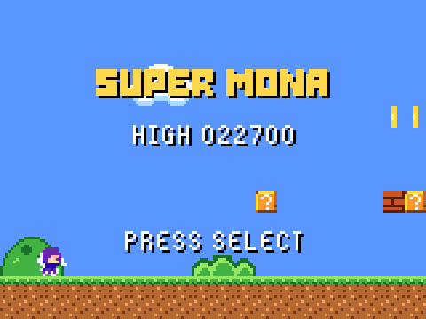
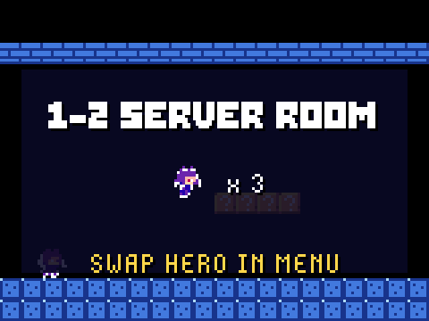
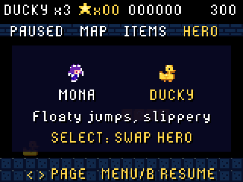

# Super Mona

An original side-scrolling platformer for the **GitHub Universe 2026 badge**.
Run, jump and stomp through three stages as Mona (or Ducky the rubber duck).

  

## Install with one Copilot prompt

Connect your badge to your computer with a USB-C data cable. Then give this
prompt to GitHub Copilot (CLI, the Copilot app or agent mode in VS Code):

```text
Install Super Mona from https://github.com/martinwoodward/super-mona onto my GitHub Universe 2026 badge, which is connected over USB. Follow the instructions in that repository's AGENTS.md.
```

Copilot clones this repository and runs the installer. The installer puts the
badge into USB mass-storage mode, copies the game across, ejects the drive and
checks that the files are on the badge.

## Install it yourself

You need Python 3.8+ and [`mpremote`](https://docs.micropython.org/en/latest/reference/mpremote.html)
(`pip install mpremote`).

```sh
git clone https://github.com/martinwoodward/super-mona
cd super-mona
python3 install.py
```

Close Thonny, Web Serial pages and any other `mpremote` sessions first, because
only one program can use the badge's serial port at a time.

If the installer can't switch modes automatically (for example, on older
firmware), double-tap the badge's reset button. When the `BADGER` drive
appears, run:

```sh
python3 install.py --volume /Volumes/BADGER   # macOS
python3 install.py --volume /media/$USER/BADGER   # Linux
python3 install.py --volume E:\   # Windows (use the BADGER drive letter)
```

**No terminal?** Double-tap reset, then drag the `super_mona` folder into the
`apps` folder on the `BADGER` drive. Eject the drive and the badge restarts.
Super Mona appears in the badge menu.

## How to play

Reach the flag at the end of each stage before the timer runs out. Collect
stars (100 earns an extra life), bump `?` blocks for power-ups, and stomp bugs
and shellbots. Kick a shell, or hold **B** to carry it and release **B** to
throw it.

| Pad | Action |
| --- | --- |
| D-pad | Move (Down crouches when big) |
| Select (A) | Jump; hold for a higher jump |
| Back (B) | Run; hold to carry a shell, release to throw it |
| Menu | Pause. Left/Right switch between PAUSED, MAP, ITEMS and HERO |
| Home | Quit to the badge menu |

See [`super_mona/README.md`](super_mona/README.md) for the pause pages,
including stored items and swapping between Mona and Ducky.

## Requirements

- GitHub Universe 2026 badge running the October 2026 (or later) firmware.
  The game uses the runtime's `badge`, `screen` and `image` globals and
  `badgeware.State`.
- No network or extra hardware is needed. The game runs in LORES (160x120).

## Repository layout

| Path | Purpose |
| --- | --- |
| `super_mona/` | The badge app. This folder is copied to `/system/apps/super_mona` |
| `install.py` | Cross-platform installer (macOS, Linux and Windows) |
| `tests/` | Host-side unit tests for the game logic and app start-up |
| `tools/build_super_mona_assets.py` | Regenerates the pixel art in `super_mona/assets/` |
| `AGENTS.md` | Deployment and development instructions for coding agents |
| `docs/` | Screenshots captured from badge hardware |

## Development

```sh
python3 -m pip install -r requirements-dev.txt
python3 -m unittest discover -s tests       # run the tests
python3 tools/build_super_mona_assets.py    # regenerate the art
python3 install.py                          # deploy to a connected badge
```

## Credits and license

Released under the [MIT License](LICENSE). The Mona sprites are derived from
the Flappy Mona artwork in [badger/home](https://github.com/badger/home)
(MIT License, © Pimoroni & GitHub). All other code and art in this repository
is original.
